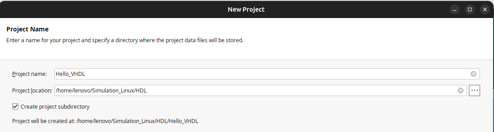
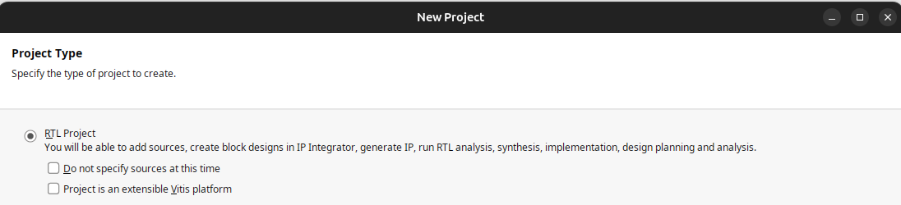
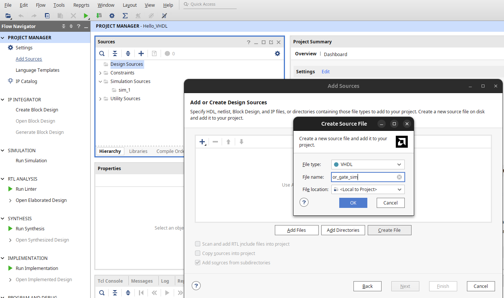
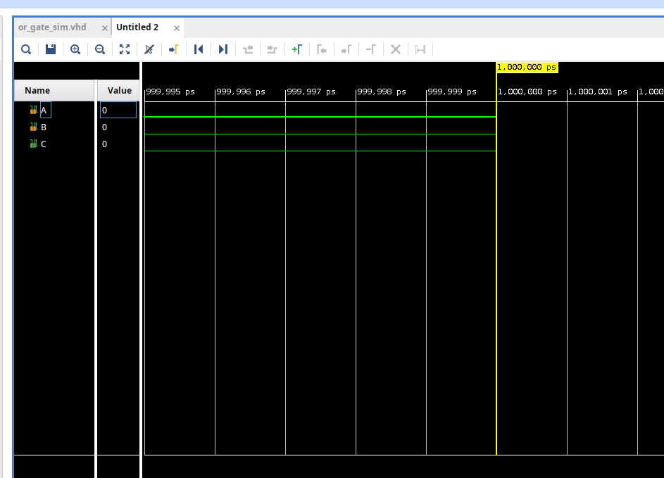
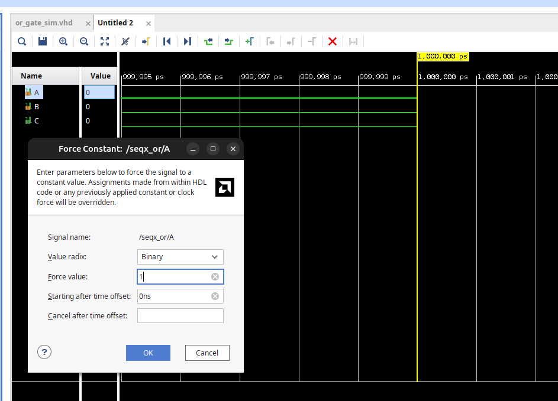
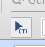
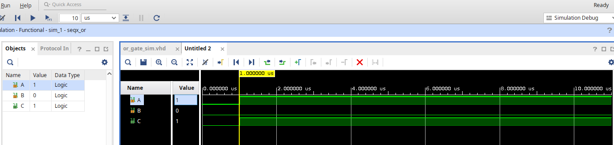

# Hello VHDL : OR gate

## Table of Contents

- [Hello VHDL : OR gate](#hello-vhdl--or-gate)
  - [Table of Contents](#table-of-contents)
  - [Context](#context)
  - [Project Configuration](#project-configuration)
  - [Inside Vivado](#inside-vivado)
    - [Create a VHDL source file](#create-a-vhdl-source-file)
  - [Some errors while typing my 1st VHDL code](#some-errors-while-typing-my-1st-vhdl-code)
  - [Running Simulation](#running-simulation)
    - [Changing Input Value](#changing-input-value)
  - [Vivado Tip: waveform (saving part)](#vivado-tip-waveform-saving-part)
    - [Saving a waveform](#saving-a-waveform)
  - [Vivado Tip: waveform (re-opening part)](#vivado-tip-waveform-re-opening-part)
    - [Open `.wdb`: active mode](#open-wdb-active-mode)
    - [Open `.wdb`: inactive mode](#open-wdb-inactive-mode)

## Context

The purpose of this lab is run a basic simulation in `VHDL` using
`Vivado` tool.

This project focuse on the following aspect:
- simulation running, input values change
- manipulating waveform:
  - saving, different extension
  - reopen and see simulation again

## Project Configuration

Once we open `Vivado`, we select on `Create Project`.

1. We give our project a name (mine is `Hello_VHDL`), and we choose the correspondant directory we want to place in (mine in `home/Simulation_Linux/HDL`).

<div id="fig1">

<p><strong>Figure 1:</strong> Setting up project name and directory</p>
</div>

2. The projec type is `RTL` for now

<div id="fig2">

<p><strong>Figure 2:</strong> Project type</p>
</div>

3. Now as for default part, that is the board part, we search for `xc7a35tcpg236-1` (this is for `Basys3` board)

<div id="fig3">

<p><strong>Figure 3:</strong> Selecting FPGA chip</p>
</div>

## Inside Vivado

After creating the project, we will have the default template for `Vivado` IDE.

### Create a VHDL source file

- In the flow navigator, under `Settings`, click on `Add Sources` 
- Choose `Create File`
- Select `File type` as `VHDL` and give the file a name, as shown in [Figure 4](#fig4)

<div id="fig4">

<p><strong>Figure 4:</strong> Creating VHDL source file</p>
</div>

## Some errors while typing my 1st VHDL code

1. when declaring enity, `entity seqx_or`, directly type `end seqx_or;` to avoid mistakes
   1. same things with architecture, processe, if else statement,....

2. Signal names like `A`,`B`, don't use `''` inside the `if-else`
   1. only bits (`1` and `0`) or character litterals use `''`

## Running Simulation

Once we finish the code, we go in the flow navigator, under `Simulation`, and click on `Run Simulation`. Once the simulation finishes, a new window appears with some waveform of the input and output as shown in [Figure 5](#fig5)

<div id="fig5">

<p><strong>Figure 5:</strong> Waveform for simulation</p>
</div>

### Changing Input Value

By default, the simulation shown in [Figure 5](#fig5) choose by default
value `0` for input `A` and `B`.

If we want to change input values, let's say for `A` for example  

- right click on `A`

- choose `Force Constant`, and choose 1 for example as shown in [Figure 6](#fig6)

<div id="fig6">

<p><strong>Figure 6:</strong> Input value changing</p>
</div>

- then we need to re-run the simulation using the `run simulation` button, where its logo is shown in [Figure 7](#fig7)

<div id="fig7">

<p><strong>Figure 7:</strong> Run simulation button</p>
</div>

Result with `A = 1` and `B = 0` is shown in [Figure 8](#fig8)

<div id="fig8">

<p><strong>Figure 8:</strong> Running simulation with A = 1</p>
</div>

- Simulation starts from 1 micro s
- Simulation last for 10 micro s

## Vivado Tip: waveform (saving part)

After finsihing simulation and obtaining waveforms, it is good practice to save the figures, since simulations sometimes can take a long time.

In this section we explore the following:

- saving figures, and different figures extension 
- reopen the figures again with or with no simulation is running

### Saving a waveform

`Vivado` automatically saves the waveform to a `.wdb` file after each run.

It saves the `.wdb` in the `<project>.sim/sim_1/behav/xsim/` directory:

```
Hello_VHDL/Hello_VHDL.sim/sim_1/behav/xsim/seqx_or_behav.wdb
```
To save the waveform **layout** (signals displayed, order, colors), we need to save it separately a `.wcfg` file

Saving manually is done via:

- the menu: `File` → `Save Waveform`

<u>**Notes:**</u>

- `.wdb` stores the raw signal data; `.wcfg` stores the view/layout preferences.

- It is good practice to save the `.wcfg` to preserve your waveform layout between sessions.
  
- In [inactive mode](#open-wdb-inactive-mode),
the `.wcfg` is necessary so we can reopen the any simulation we want, for example [Figure 8](#fig8)

- In other words, both `.wcfg` and `.wdb` files are necessary
  - one the for raw data
  - one for the layout

## Vivado Tip: waveform (re-opening part)

Whenever we want to re-open or see simulation again, there are 2 modes in `Vivado`:

- simulation is still running
  - I refer to that active mode
- simulation is closed
  - I refer to that inactive mode

We explore both options in this section.

We can practice using [Figure 8](#fig8)

### Open `.wdb`: active mode

If we close the waveform and we want to open it again without restarting the simulation:

- From the menu: `Window` → `Waveform` — reopens the waveform panel if the simulation session is still active

### Open `.wdb`: inactive mode

- From menu we go to `Flow`-> `Open static simulation`
- we select the `.wdb` file as stated in [Saving a waveform](#saving-a-waveform)

Since I saved also [Figure 8](#fig8) as `.wcfg` file, we see the results again exactly as they were.
