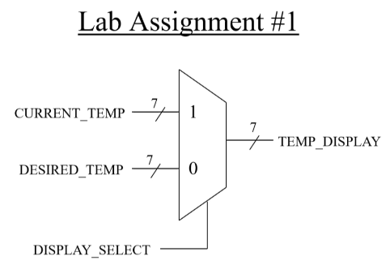

# Thermostat Lab

## Introduction

To grasp different `VHDL` concept, we will work thgrough the **thermostat lab** through various stages, that is each time we learn a new `VHDL` concept, we add and expand more.

### Intro to theremostat system

[Figure 1](#fig1) presents the thermostat system we want to work with.

<strong>Figure 1:</strong> Thermostat system

## Some errors while coding

- `if-else` in `VHDL`
  - don't forget the keyword `then` after the `if`
  - not like normal programming languages, like no `then` is used in these languges, directly we type the statement
