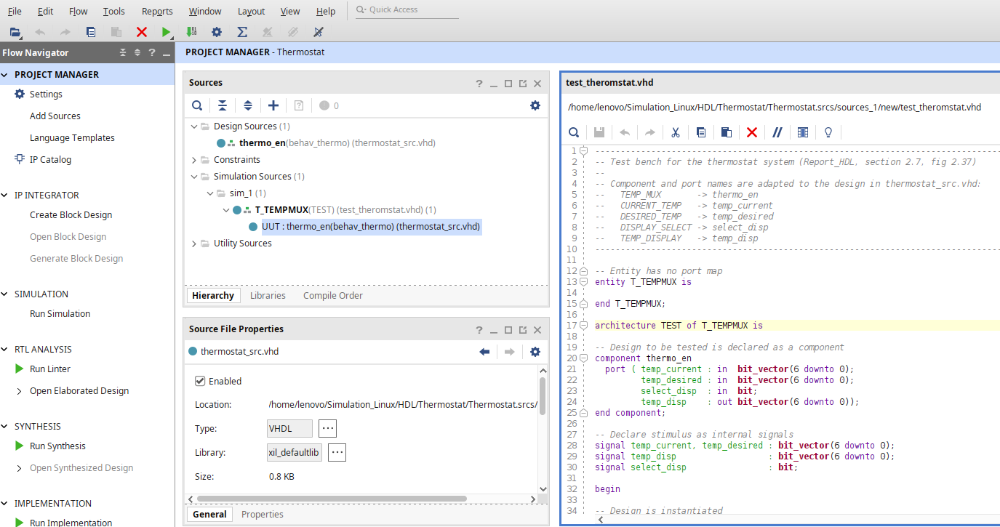
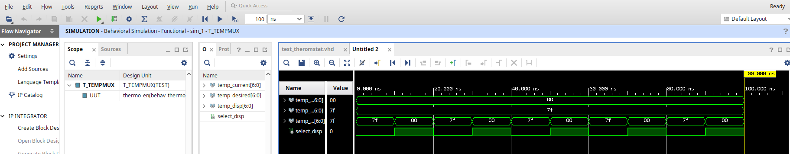
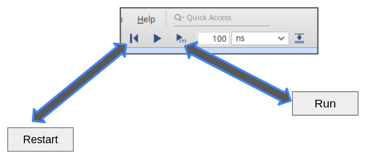
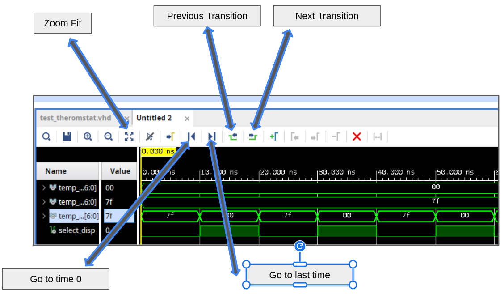

# Thermostat Lab

## Introduction

To grasp different `VHDL` concept, we will work thgrough the **thermostat lab** through various stages, that is each time we learn a new `VHDL` concept, we add and expand more.

### Intro to theremostat system

[Figure 1](#fig1) presents the thermostat system we want to work with.

<strong>Figure 1:</strong> Thermostat system

<u>Description:</u>
- if `SELECT_DISP` = 1, then `DISPLAY_TEMP` get assigned to `TEMP_CURRENT`
- otherwise `DISPLAY_TEMP`get assigned to `TEMP_DESIRED`

This desing is implemented in `Vivado` inside the project `Thermostat`.
  - its source file `thermostat_src.vhd`

## Test bench

To test our desing we implement also a simple test bench file, called `test_thermostat.vhd`
- the test file is also created as seen in `Hello_VHDL_OR.md`
- however for test file, the `test_thermostat.vhd` need to be in `Simulation Sources`, under sources in project manager as shown in [Figure 2](#fig2)

<strong>Figure 2:</strong> Thermostat test file location

Now to run the simulation, in the **flow navigator** press **Run Simulation**. The results for the simulation is shown in [Figure 3](#fig3)

<strong>Figure 3:</strong> Running test file simlation

<u>Note: time scaling</u>

Since in our test file we are waiting for 10 ns, it is preferred to adjust the time scale of the simulation, becaue `Vivado` may not run directly in our time scale. As a matter of fact, the result shown in [Figure 3](#fig3) was adjusted using the options underneath `Help` tab
- I modified the simulation time scale an choose ns (before it was autmatically set for in micro s)
- I then press `Restart` and `Run`, using buttons shown in [Figure 4](#fig4)

<strong>Figure 4:</strong> Simulation Buttons

Also to navigate the wave figure and see results, use navigation buttons shown in [Figure 5](#fig5)

<strong>Figure 5:</strong> Navigating the wav test

## Some errors while coding

### if-else

- don't forget the keyword `then` after the `if`
- not like normal programming languages, like no `then` is used in these languges, directly we type the statement
